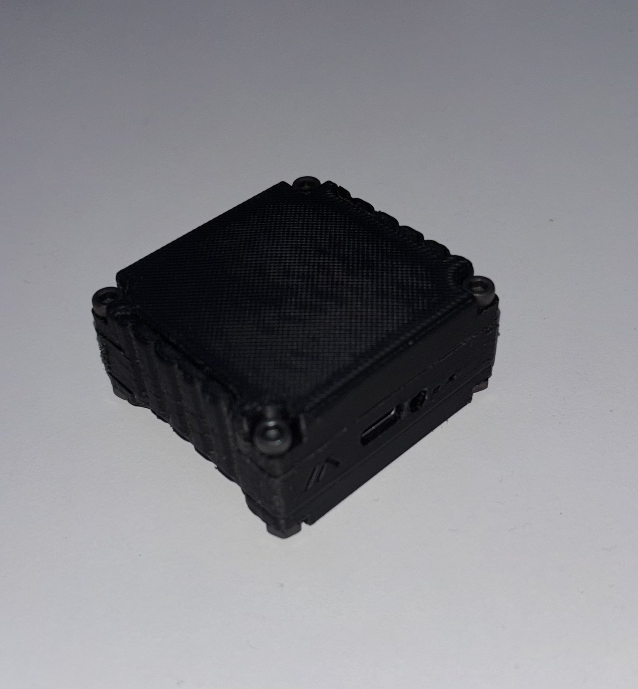
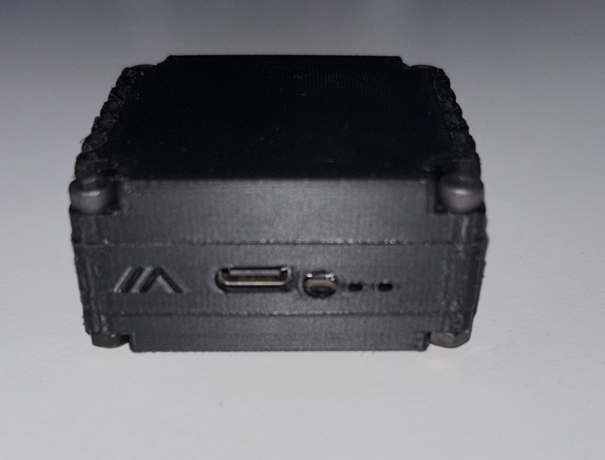
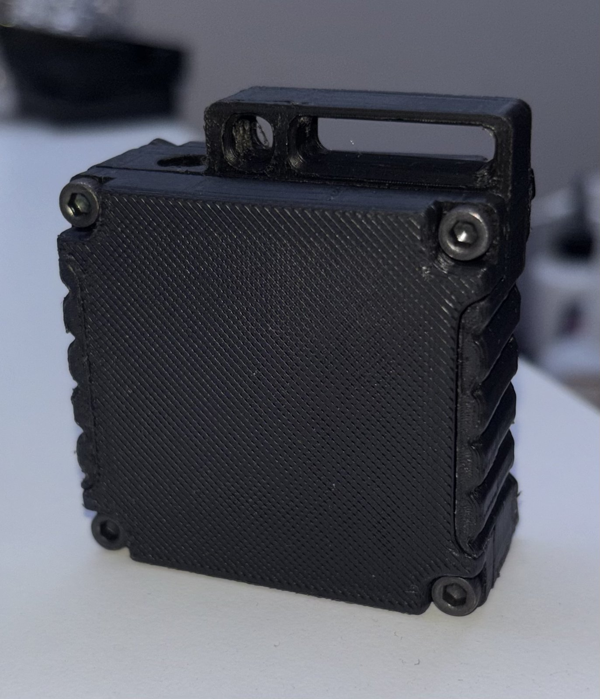

# G7 Bridge

**English** · [Polski](README.pl.md)

## Why G7 Bridge

A Dexcom G7 sensor only talks to a phone a few metres away. So at practice, in PE or on
the playground the phone has to come along — in a running belt, a hip bag or a pocket that bounces
with every step. It is uncomfortable, it gets in the way of the game, and phones get broken.

G7 Bridge is a small, light module that fits in a pocket. It stays close to the sensor, reads the
glucose every 5 minutes and passes it on to the phone, which can stay in the locker room or on the
bench — up to about 50 m away. xDrip+ and AndroidAPS keep working as usual, and if the
phone is briefly out of range, the bridge keeps the readings and sends them as soon as the link is
back.

**The goal is simple: let the child just train — with the parent still seeing every reading.**

## How it looks like

  
  
  

The finished G7 Bridge: a RAK4631 on a RAK19003 base board with a battery, in a 3D-printed case.
On the front: the USB-C port for charging, the RESET button and the LEDs.
Size: **47 × 50 × 24 mm** (width × length × thickness).

## Quick start

You need: a RAKwireless **RAK4631** on a **RAK19007/RAK19003** base board with a BLE antenna and a
small Li-Po battery, an Android phone with **Chrome** and **xDrip+**, and the 4-digit code from the
sensor applicator.

1. **[Firmware](firmware/README.md)** (full instructions there) — download `g7-bridge-rak4631-<version>.uf2` from
   [Releases](https://github.com/TomaszSmart/Dexcom-G7-CGM-Extender-Bridge/releases/latest), press
   RESET twice on the board and copy the file onto the `RAK4631` drive (a copy error from Windows
   at the end is normal — the board restarts as soon as it has the file).
2. **Power the bridge up.** The next steps 3–5 must happen within **10 minutes** (phones can only
   pair in that window; afterwards press RESET once and continue).
3. **Page or app** — open https://g7bridge.b-hubit.com in Chrome and tap **Connect to bridge**,
   or install the [Android app](android/README.md) and tap **Connect**; choose “G7 Bridge” and
   accept the pairing request.
4. **G7 configuration** — in “G7 configuration” tap **From the xDrip+ documentation**, then
   **Send to bridge** (once per bridge; they survive updates).
5. **xDrip+** — Settings → **Hardware Data Source** → **SmartGuide**, choose “G7 Bridge” and accept
   the pairing request. The bridge drops the phone once after pairing; xDrip+ reconnects by itself.
   AndroidAPS keeps xDrip+ as its BG source.
6. **Sensor** — stop data collection on any other phone connected to the sensor, or use a new
   sensor, enter the applicator code under **New sensor** and tap **Pair**. Within up to 30 minutes the bridge finds
   the sensor and readings appear in xDrip+.

Updating later: the page shows when a newer firmware is available; flash it the same way as in
step 1. Settings, the G7 configuration and pairings are kept.

## The page

Web page for G7 Bridge, which receives readings from a
Dexcom G7 sensor and forwards them to xDrip+ as a standard Bluetooth CGM service.

**Page:** https://g7bridge.b-hubit.com

Open it in Chrome on Android (Web Bluetooth is required), tap “Connect to bridge” and choose
“G7 Bridge”. The page shows the latest reading, the sensor's state and session day, the bridge
battery, the radio range and the sensors in range. When you change the sensor, just enter the
4-digit code from the applicator. The page language can be switched between English and Polish
(top right); English is the default.

A phone can only be paired with G7 Bridge within 10 minutes of powering it up.

## Connect automatically after reloading the page

By default Chrome needs a click on “Connect to bridge” after every reload (a Web Bluetooth
safeguard). To let the page reconnect to the remembered bridge by itself:

1. Type in the address bar: `chrome://flags/#enable-web-bluetooth-new-permissions-backend`
2. Set “Use the new permissions backend for Web Bluetooth” to **Enabled**.
3. Tap **Relaunch** (Chrome restarts).
4. Open the page and connect to the bridge once with the button.

From then on the page reconnects by itself within a few seconds after a reload. After clearing
the site data or its permissions, connect once with the button again. This is an experimental
Chrome flag, so it may change in future versions.

## Bridge LEDs

| LED | Meaning |
|---|---|
| green 1× every 5 s | sensor OK, fresh reading, xDrip connected |
| green 2× every 5 s | sensor OK but xDrip not connected, or the sensor is warming up |
| green + blue 3× every 5 s | problem: no reading for over 15 min, sensor failure or end of the sensor session |
| green + blue 1× every 2 s | after power-on, waiting for the first reading |
| blue blinking | searching for the sensor that matches a new code |
| blue 1× every 5 s | no pairing code or sensor set |
| red steady | battery charging LED |

## The Android app

The [G7 Bridge app](android/README.md) does what the page does, without Chrome, and watches the
bridge in the background: it warns when the bridge's battery runs low and also reports problems,
e.g. why no data arrives (bridge out of reach, sensor not heard, xDrip+ not collecting, end of the
sensor session). Glucose
alarms stay in xDrip+. Download the APK from the newest **app-v…** release.

## Bridge firmware

The bridge firmware (RAKwireless RAK4631 WisBlock) is in [firmware/](firmware/README.md):
boards, installation, first setup and building from source. The G7 configuration (the QR code from the xDrip+
documentation) is not part of it; you load it into your own bridge from the page or the app.

## Repository

| Folder | What | Releases |
|---|---|---|
| [firmware/](firmware/README.md) | bridge firmware (RAK4631) | tags `v…` → `.uf2` |
| [web/](web/index.html) | setup page, published on https://g7bridge.b-hubit.com | — |
| [android/](android/README.md) | Android app | tags `app-v…` → `.apk` |

## License

GPL-3.0 (see [LICENSE](LICENSE)). The G7 authentication follows xDrip+ (libkeks), which is GPL-3.0.

## Privacy

The page runs entirely in the browser and the app entirely on the phone; neither sends any data
anywhere. They only ask GitHub for the latest firmware version and load the G7 configuration QR code
from the xDrip+ documentation.

> Hobby project, not a medical device. Make treatment decisions based on approved devices.
